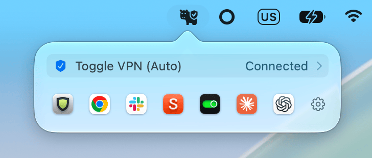

  

<h1 align="center">CapyBar</h1>

  Hide menu bar icons on macOS 27. Free and open source.

  
  
  
  

  <a href="https://github.com/stepn1k/CapyBar/releases/latest/download/CapyBar.zip"><b>Download</b></a> ·
  <a href="#features">Features</a> ·
  <a href="#install">Install</a> ·
  <a href="#faq">FAQ</a>

  

Too many menu bar icons, or some stuck behind the notch? CapyBar hides the ones you pick and keeps them one click away, under the capybara.

- **Private.** No analytics, no accounts. Goes online only to check for updates, if you allow it.
- **One permission.** Accessibility, nothing else.
- **Safe.** If CapyBar quits or crashes, every icon comes back. Signed and notarized by Apple.
- **Stays put.** Icons stay hidden after sleep, restarts and app updates.

## Features

### Find any icon from the keyboard

Set a shortcut in Options, then pick an icon with the arrow keys and open it with <kbd>Return</kbd>. Or just start typing to search.

  

### See your VPN at a glance

When a VPN is on, the capybara wears a small shield. The VPN sits at the top of the panel, even if its own icon is hidden.

  

## Install

1. [Download CapyBar](https://github.com/stepn1k/CapyBar/releases/latest/download/CapyBar.zip), unzip it and open CapyBar.app. It moves itself to Applications.
2. Allow Accessibility when asked.
3. Click the capybara, then the gear, and switch on the apps you want to hide. Their icons move into the panel under the capybara.

## FAQ

<b>My menu bar icons are hidden behind the notch. How do I get to them?</b>

Hide the icons you don't need every day, and the rest fit next to the notch again.

<b>Is CapyBar an alternative to Bartender, Ice or Hidden Bar?</b>

Yes, for the main job: choosing which icons are shown. CapyBar is free, uses macOS 27's own menu bar allowlist, and hides whole apps rather than single icons.

<b>Does CapyBar need Screen Recording?</b>

No. Accessibility is the only permission.

<b>Why do hidden icons show while Notification Center is open?</b>

macOS 27 puts tight limits on what apps can do with the menu bar, and while icons are hidden it blocks Notification Center. Showing them while it is open is the only way to keep it working. A two-finger swipe from the right edge of the trackpad opens it without showing them.

<b>Why did Focus or Now Playing disappear from the menu bar?</b>

While any app is hidden, macOS also hides some of its own icons, like Focus and Now Playing.

<b>Can a macOS update break CapyBar?</b>

It can, because CapyBar uses a private part of macOS. If that changes, CapyBar stops hiding and every icon stays visible until CapyBar is updated.

<b>How do I uninstall it?</b>

Right-click the capybara and choose Uninstall CapyBar. It removes its settings and permission, then moves itself to the Trash. If you deleted it by hand, also run `defaults delete app.capybar.CapyBar`.

## More

[How it works](docs/HOW_IT_WORKS.md) · [Build it yourself](CONTRIBUTING.md#build) · [Reliability](docs/RELIABILITY.md) · [Security](SECURITY.md) · [Contributing](CONTRIBUTING.md) · [Questions](https://github.com/stepn1k/CapyBar/discussions) · [Report a bug](https://github.com/stepn1k/CapyBar/issues/new/choose)

CapyBar is [MIT](LICENSE) licensed.
