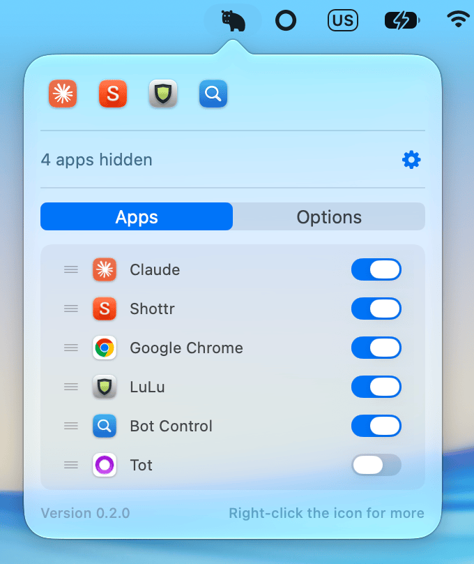

<p align="center">
  
</p>

<h1 align="center">CapyBar</h1>

<p align="center">
  Hide menu bar icons on macOS 27.
</p>

<p align="center">
  
  
</p>

<p align="center">
  
  
  
</p>

Too many menu bar icons, or some stuck behind the notch? CapyBar hides the ones you pick and keeps them one click away, under the capybara.

- **Private.** No analytics, no accounts, no Screen Recording. Goes online only when you ask it to check for updates.
- **One permission.** Accessibility, granted once.
- **Safe.** Quit CapyBar, or let it crash, and every icon comes back.

## Install

<!-- download:start -->
**[Download CapyBar 0.2.1](https://github.com/stepn1k/CapyBar/releases/latest/download/CapyBar.zip)** · built 2026-11-24
<!-- download:end -->

1. Unzip and drag **CapyBar.app** into **Applications** (it only works from there).
2. Open it. CapyBar isn't notarized, so macOS blocks it: click **Done**, then **System Settings → Privacy & Security → Open Anyway**.
3. Grant **Accessibility** when asked and pick the apps to hide. macOS asks again after every update.

Or build it yourself with the Command Line Tools:

```bash
git clone https://github.com/stepn1k/CapyBar.git && cd CapyBar && scripts/bundle.sh --install
```

## Using it

- **Click** the capybara to see hidden icons; click one to open its menu.
- **Gear** opens settings: **Apps** to choose and reorder, **Options** for the rest.
- **Right-click** for Show All Icons, Check for Updates, Uninstall and Quit.

Automatic update checks are off by default. A check fetches one small version file from GitHub and sends nothing about you.

## Good to know

- Apps are hidden whole: an app with several icons loses all of them.
- While anything is hidden, macOS 27 also hides some system icons, like Focus or Now Playing.
- Hold **Option** while launching to start with every icon visible.

## Uninstall

Right-click the capybara → **Uninstall CapyBar…**. It removes its permission, login item and settings, then moves itself to the Trash.

Deleted it by hand? Run `defaults delete app.capybar.CapyBar` and remove CapyBar from **Privacy & Security → Accessibility**.

## Contributing

Issues and PRs welcome: see [CONTRIBUTING.md](CONTRIBUTING.md), [How it works](docs/HOW_IT_WORKS.md) and [SECURITY.md](SECURITY.md).

## License

[MIT](LICENSE)
