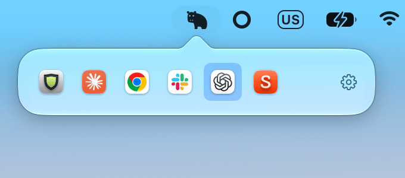
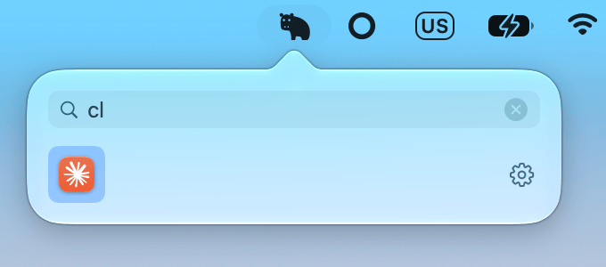
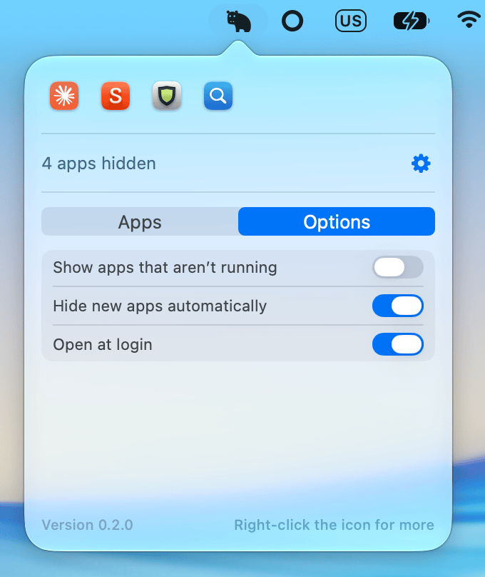

<p align="center">
  
</p>

<h1 align="center">CapyBar</h1>

<p align="center">
  Hide menu bar icons on macOS 27. Free and open source.
</p>

<p align="center">
  
  
  <a href="https://github.com/stepn1k/CapyBar/releases/latest"></a>
</p>

<p align="center">
  <a href="https://github.com/stepn1k/CapyBar/releases/latest/download/CapyBar.zip"><b>Download</b></a> ·
  <a href="#install">Install</a> ·
  <a href="#usage">Usage</a> ·
  <a href="#faq">FAQ</a> ·
  <a href="#docs">Docs</a>
</p>

<p align="center">
  
</p>

Too many menu bar icons, or some stuck behind the notch? CapyBar hides the ones you pick and keeps them one click away, under the capybara.

- **Private.** No analytics, no accounts. Goes online only when you ask it to check for updates.
- **One permission.** Accessibility, granted once.
- **Safe.** Quit CapyBar, or let it crash, and every icon comes back.
- **Stays put.** Hidden icons stay hidden after sleep, a restart or an app update. [How that's checked](docs/RELIABILITY.md).

## Install

**[Download the latest CapyBar](https://github.com/stepn1k/CapyBar/releases/latest/download/CapyBar.zip)** ([release notes](https://github.com/stepn1k/CapyBar/releases))

1. Unzip and open **CapyBar.app**.
2. macOS blocks it, because CapyBar isn't notarized yet: click **Done**, then **System Settings → Privacy & Security → Open Anyway**.
3. CapyBar moves itself into **Applications** (it only works from there) and opens again.
4. Grant **Accessibility** when asked and pick the apps to hide.

Or build it yourself with the Command Line Tools:

```bash
git clone https://github.com/stepn1k/CapyBar.git
cd CapyBar
scripts/bundle.sh --install
```

## Usage

- **Click** the capybara to see hidden icons, then click one to open its menu.
- **Click the gear** for settings: **Apps** to choose and reorder, **Options** for the rest.
- **Right-click** the capybara for Show All Icons, Check for Updates, Uninstall and Quit.
- **Hold Option** while launching CapyBar to start with every icon visible.

| Key | Action |
|---|---|
| Your shortcut | Open CapyBar from any app. Record one in **Options**; there's none by default |
| ← → ↑ ↓ | Choose an icon |
| Return | Open its menu |
| Type, or ⌘F | Search |
| Esc | Close the search, then CapyBar |

Hover over the capybara to see your shortcut. The **?** in settings lists these keys too.

<p align="center">
  
  
  <br>
  <sub>Pick an icon with the arrow keys, or type to search</sub>
</p>
<p align="center">
  
  
  <br>
  <sub>Settings: choose apps to hide, and options</sub>
</p>

## Limitations

- Apps are hidden whole: an app with several icons loses all of them.
- While anything is hidden, macOS 27 also hides some system icons, like Focus or Now Playing.
- Updates install like the first download, and macOS asks for Accessibility again after each one.
- CapyBar is in beta and relies on a private macOS API. If a macOS update changes it, hiding turns off and every icon stays visible until CapyBar is updated.

## Uninstall

Right-click the capybara → **Uninstall CapyBar…**. It removes its permission, login item and settings, then moves itself to the Trash.

Deleted it by hand? Remove CapyBar from **Privacy & Security → Accessibility** and clear its settings:

```bash
defaults delete app.capybar.CapyBar
```

## FAQ

### How do I hide menu bar icons on macOS 27?

Install CapyBar, grant Accessibility, and switch off the apps you want gone in **Settings → Apps**. Their icons leave the menu bar and wait in the capybara's panel.

### My menu bar icons are hidden behind the notch. How do I get to them?

Hide the icons you don't need every day, and the rest fit next to the notch again. The hidden ones stay one click away in the panel.

### Is CapyBar an alternative to Bartender, Ice or Hidden Bar?

For the main job, yes: you choose which menu bar icons are shown. CapyBar is free, MIT-licensed and built on macOS 27's own menu bar allowlist ([how it works](docs/HOW_IT_WORKS.md)). It hides whole apps rather than single icons.

### Does CapyBar need Screen Recording?

No. Accessibility is the only permission. The panel shows app icons, not captures of the menu bar.

### macOS says CapyBar can't be opened. What do I do?

CapyBar isn't notarized yet, so macOS blocks the first launch. See [Install](#install), step 2.

## Docs

| I want to… | Read |
|---|---|
| Know how hiding works, and its limits | [How it works](docs/HOW_IT_WORKS.md) |
| Know why icons stay hidden, or check it myself | [Reliability](docs/RELIABILITY.md) |
| Know what CapyBar can access | [Security](SECURITY.md) |
| Ask a question or suggest an idea | [Discussions](https://github.com/stepn1k/CapyBar/discussions) |
| Report a bug | [Issues](https://github.com/stepn1k/CapyBar/issues/new/choose) |
| Build, test or send a PR | [Contributing](CONTRIBUTING.md) |
| Change the code, as a person or an AI agent | [AGENTS.md](AGENTS.md): file map, rules, checklist |

## License

[MIT](LICENSE)
