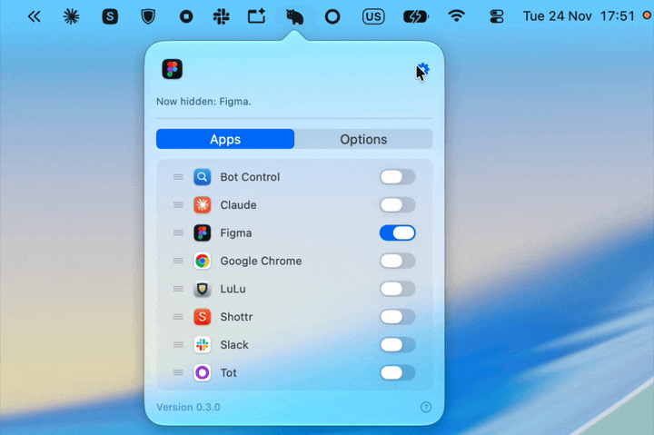

<p align="center">
  
</p>

<h1 align="center">CapyBar</h1>

<p align="center">
  Hide menu bar icons on macOS 27. Free and open source.
</p>

<p align="center">
  
  
  <a href="https://github.com/stepn1k/CapyBar/releases/latest"></a>
</p>

<p align="center">
  <a href="https://github.com/stepn1k/CapyBar/releases/latest/download/CapyBar.zip"><b>Download</b></a> ·
  <a href="#install">Install</a> ·
  <a href="#usage">Usage</a> ·
  <a href="#faq">FAQ</a>
</p>

<p align="center">
  
</p>

Too many menu bar icons, or some stuck behind the notch? CapyBar hides the ones you pick and keeps them one click away, under the capybara.

- **Private.** No analytics, no accounts. Goes online only to check for updates, if you allow it.
- **One permission.** Accessibility, nothing else.
- **Safe.** If CapyBar quits or crashes, every icon comes back.
- **Stays put.** Icons stay hidden after sleep, restarts and app updates.

## Install

1. [Download CapyBar](https://github.com/stepn1k/CapyBar/releases/latest/download/CapyBar.zip), unzip it and open CapyBar.app.
2. macOS blocks it the first time, because CapyBar isn't notarized yet. Click Done, then go to System Settings → Privacy & Security and click Open Anyway.
3. CapyBar moves itself to Applications and opens again.
4. Allow Accessibility when asked.

To build it yourself:

```bash
git clone https://github.com/stepn1k/CapyBar.git
cd CapyBar
scripts/bundle.sh --install
```

## Usage

1. Click the capybara, then the gear, and switch on the apps you want to hide.
2. Their icons leave the menu bar. To reach one, click the capybara, then click its icon.
3. Right-click the capybara to show all icons again, check for updates or quit.

You can also set a keyboard shortcut in Options. Then pick an icon with the arrow keys, open it with <kbd>Return</kbd>, or just start typing to search.

<p align="center">
  
  
</p>

## Limitations

- An app is hidden with all of its icons. You can't hide just one of them.
- While anything is hidden, macOS also hides some system icons, like Focus and Now Playing.

## FAQ

### My menu bar icons are hidden behind the notch. How do I get to them?

Hide the icons you don't need every day, and the rest fit next to the notch again.

### Is CapyBar an alternative to Bartender, Ice or Hidden Bar?

Yes, for the main job: choosing which icons are shown. CapyBar is free, uses macOS 27's own menu bar allowlist, and hides whole apps rather than single icons.

### Does CapyBar need Screen Recording?

No. Accessibility is the only permission.

### macOS says CapyBar can't be opened. What do I do?

Click Done, then go to System Settings → Privacy & Security and click Open Anyway.

### Why does macOS ask for Accessibility again after an update?

CapyBar isn't signed with an Apple developer certificate yet, so macOS treats each update as a new app. Allow it again.

### Can a macOS update break CapyBar?

It can, because CapyBar uses a private part of macOS. If that changes, CapyBar stops hiding and every icon stays visible until CapyBar is updated.

### How do I uninstall it?

Right-click the capybara and choose Uninstall CapyBar. It removes its settings and permission, then moves itself to the Trash. If you deleted it by hand, also run `defaults delete app.capybar.CapyBar`.

## More

[How it works](docs/HOW_IT_WORKS.md) · [Reliability](docs/RELIABILITY.md) · [Security](SECURITY.md) · [Contributing](CONTRIBUTING.md) · [Questions](https://github.com/stepn1k/CapyBar/discussions) · [Report a bug](https://github.com/stepn1k/CapyBar/issues/new/choose)

CapyBar is [MIT](LICENSE) licensed.
